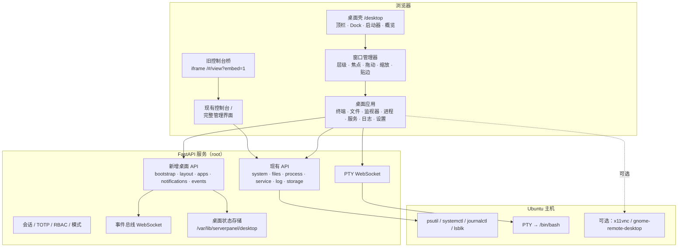

# 基于 AegisServerPanel 的 Ubuntu Web 桌面
## 可行性与技术方案

| 项目 | 内容 |
|---|---|
| 文档版本 | v0.1 |
| 日期 | 2026-11-08 |
| 底座 | AegisServerPanel 2.0 |
| 产品形态 | 浏览器内的 Ubuntu 风格 Web 桌面 |
| 目标用户 | 个人自用 / 极客玩家，单机部署 |
| 结论 | **可行**。后端可复用约 90%，前端需要新建桌面壳，不建议在现有 `app.js` 上直接叠加 |

---

## 0. 结论摘要

1. **技术可行性高**：桌面需要的四块核心能力——身份认证、命令执行、PTY 终端、文件读写——底座已经具备，并且经过完整测试覆盖。新增工作主要集中在**前端窗口系统**与**桌面状态服务**。
2. **推荐架构是"双前端、共享后端"**：保留现有控制台 `/`，新增独立桌面 SPA `/desktop`，两者共用同一套 FastAPI 接口、会话与 RBAC。不要把窗口管理器塞进 300KB 的 `app.js`。
3. **"Ubuntu 桌面"要分三层理解**：
   - L1 Web 应用桌面：所有应用都是调用服务端 API 的 Web UI。**完全可行，体验最好**。
   - L2 原生应用串流：用 xpra 把单个 GUI 程序窗口投到浏览器。局域网可行，Wayland 下复杂。
   - L3 完整远程桌面：Guacamole + RDP/VNC，得到真正的 GNOME 桌面。**本质是远程桌面网关**，不是 Web OS。
   建议 **先做 L1，把 L3 作为可选应用**，L2 延后。
4. **最大风险不是技术，是安全模型**：面板以 root 运行，桌面等于把 root shell 常驻化。个人自用可以接受，但必须限定为 **内网 / VPN + TLS + TOTP + 空闲锁定**，不要直接暴露公网。
5. **落地路径**：M0 技术验证（窗口管理器 + 多终端）→ M1 桌面壳 → M2 核心应用 → M3 体验整合 → M4 原生串流 → M5 安全加固。

---

## 1. 目标与非目标

### 1.1 产品定义

打开浏览器访问 `http://<host>:8787/desktop`，登录后进入一个类 Ubuntu GNOME 的桌面：

- 顶部状态栏：活动、时钟、系统托盘、网络/CPU/内存状态
- 左侧 Dock：常用应用、运行中应用指示点
- 桌面区域：可拖动、缩放、最小化、最大化、贴边分屏的窗口
- 应用：终端、文件、系统监视器、进程、服务、日志、设置、应用中心、远程桌面
- 桌面状态持久化：窗口位置、Dock 固定项、壁纸、主题、快捷键
- 可选：PWA 安装、开机 kiosk、移动端自适应

### 1.2 典型用户故事

1. 我在手机/平板上打开面板地址，进入桌面，双击"终端"开两个窗口，一个跑 `htop`，一个跑 `journalctl -f`。
2. 我把本地文件拖进"文件"窗口，直接上传到 `/home/ubuntu`；再双击一个 `.log` 文件用日志查看器打开。
3. 我打开"系统监视器"，看到 CPU 曲线和告警；点击告警弹出通知中心。
4. 我打开"应用中心"，一键启动 nginx 容器，Dock 出现运行指示点。
5. 我重启浏览器，桌面恢复上次的窗口布局和打开的目录。

### 1.3 非目标（第一阶段明确不做）

- 替代 GNOME/KDE 成为机器的主桌面环境
- 在浏览器里直接运行任意 `.deb` / GTK / Qt 程序（只能串流）
- 多租户 SaaS、跨主机纳管、集群编排
- 第三方 JavaScript 应用市场（安全模型未成熟前不做）
- 完整的窗口合成器特效（模糊、透明、动画编排）

### 1.4 成功标准

| 维度 | 标准 |
|---|---|
| 功能 | 6 个核心应用可用；窗口可拖动/缩放/最大化/贴边；刷新后布局恢复 |
| 安全 | 未登录不可见任何系统数据；危险操作有确认令牌；审计可查；公网直连默认不可用 |
| 性能 | 局域网内桌面首屏 < 1.5s；10 个窗口拖动无明显掉帧；后台标签停止轮询 |
| 兼容 | Chrome / Edge / Firefox / Safari 最近两个大版本；1366×768 起可用 |
| 回归 | 现有 325 个后端测试保持全绿；控制台功能零回归 |

---

## 2. 现有资产盘点

### 2.1 可直接复用的后端能力

| 能力 | 现有实现 | 桌面中的用法 | 改造量 |
|---|---|---|---|
| 登录 / 会话 | [auth.py](../app/auth.py#L234-L419)、Cookie + Bearer、会话哈希落盘 | 桌面与应用共用登录态 | 无 |
| TOTP / 锁定 | [totp.py](../app/totp.py)、失败退避 | 桌面登录直接继承 | 无 |
| RBAC | [auth.py](../app/auth.py#L421-L599) 三档角色、路径级白名单 | 应用可见性与接口门禁 | 无 |
| 双模式 | [config.py](../app/config.py#L91-L98)、`require_internal` | 桌面要求内网模式 | 无 |
| PTY 终端 | [terminal_routes.py](../app/routes/terminal_routes.py)、xterm.js | 多窗口终端 | 小 |
| 文件管理 | [file_routes.py](../app/routes/file_routes.py)、[trash.py](../app/trash.py) | 文件管理器 | 小 |
| 性能指标 | [metrics.py](../app/metrics.py)、[metrics_store.py](../app/metrics_store.py) | 监视器、状态栏 | 小 |
| 进程 / 服务 / 存储 / 日志 | process / service / storage / log 路由 | 对应应用 | 无 |
| 常驻应用守护 | [apps.py](../app/apps.py) | 应用中心"已安装应用" | 小 |
| 应用市场模板 | [market.json](../app/market.json) | 应用中心"可安装应用" | 小 |
| 告警 | [alerts.py](../app/alerts.py) | 通知中心 | 中（需要事件推送） |
| 审计 | [audit.py](../app/audit.py) | 桌面操作审计 | 小 |
| 参数 / 配置 | [prefs.py](../app/prefs.py) | 桌面设置 | 小 |
| PWA | [sw.js](../static/sw.js) | 桌面壳离线缓存 | 中（需要新缓存清单） |

### 2.2 前端资产：能借鉴，不能直接复用

现有前端是单文件 [app.js](../static/app.js)（约 300KB），核心机制：

- `registerView(id, def)` 注册视图，`def.render(container, resources)` 返回 cleanup（[app.js](../static/app.js#L529)、[app.js](../static/app.js#L689-L760)）
- `NAV` 定义导航与权限过滤（[app.js](../static/app.js#L507-L527)）
- `live` 总线 2 秒轮询指标（[app.js](../static/app.js#L465-L500)）
- 终端视图直接创建 xterm + WebSocket（[app.js](../static/app.js#L1259-L1360)）
- `api` 封装 fetch（[app.js](../static/app.js#L316)）

**关键判断**：这些视图大量使用全局 `$()`、固定 DOM id、整页布局假设。直接把一个视图塞进窗口会导致 ID 冲突、CSS 冲突、事件串台。因此：

> 桌面端应新建独立模块，复用 **后端 API 与工具函数思路**，不直接复用视图 DOM。

迁移期可以用 **iframe 桥**：桌面窗口内嵌 `/#/files?embed=1`，用现有控制台页面充当"旧应用"，逐个替换为原生桌面应用。

### 2.3 现有安全设计对桌面的价值

- 高风险操作已有服务端确认令牌（[main.py](../app/main.py#L150-L168)）
- 状态变更请求做 Origin 同源校验，Cookie 为 HttpOnly + SameSite（[main.py](../app/main.py#L171-L201)）
- WebSocket 有 Origin 校验、会话续期校验、角色校验（[auth.py](../app/auth.py#L729-L793)）
- CSP、HSTS、`no-store` 已就绪（[main.py](../app/main.py#L186-L219)）

这些是桌面能安全落地的基础，**不要绕过它们另起一套鉴权**。

---

## 3. 差距分析

| 能力 | 现状 | 缺口 | 优先级 |
|---|---|---|---|
| 窗口管理器 | 无 | 窗口创建/层级/焦点/拖动/缩放/最大化/贴边/多工作区 | P0 |
| 桌面壳 | 侧边栏 + 多标签 | 顶栏、Dock、启动器、概览、桌面图标、右键菜单 | P0 |
| 应用注册表 | 前端硬编码 `NAV` | 可安装/可扩展的 manifest、图标、权限、窗口默认值 | P0 |
| 应用运行时 | 整页视图 | 独立窗口容器、生命周期、单例/多实例 | P0 |
| 状态持久化 | 设置项 | 窗口布局、Dock 固定项、壁纸、快捷键 | P1 |
| 事件推送 | HTTP 轮询 | WebSocket 事件总线（告警、应用状态、模式变化） | P1 |
| 通知中心 | toast | 通知历史、未读、操作按钮 | P1 |
| 文件拖放 | 上传按钮 | 拖入上传、拖出下载、目录拖放 | P1 |
| 全局搜索 | 命令面板 `Ctrl/⌘+K` | 搜应用、文件、进程、设置项 | P1 |
| 剪贴板 | 复制文本 | 浏览器与终端/原生应用剪贴板桥 | P2 |
| 原生 GUI 串流 | 无 | noVNC / xpra / Guacamole 集成 | P2 |
| 移动端 | 响应式表单 | 窗口全屏化、手势、软键盘 | P2 |
| 可访问性 | 基础 | 焦点管理、ARIA、键盘导航 | P2 |
| 第三方应用隔离 | 无 | 独立源 + iframe sandbox + 权限令牌 | P3 |

---

## 4. 可行性分项评估

| 维度 | 评估 | 依据 |
|---|---|---|
| 技术可行性 | **高** | 认证、PTY、文件、监控、服务管理全部已有；新增主要是前端 |
| 安全可行性 | **中** | root 权限 + 桌面常驻 + 更多入口，攻击面显著扩大；需要网络与认证约束 |
| 性能可行性 | **中高** | 原生 JS 无框架开销；但窗口拖动、图表、文件列表需要专门优化 |
| 兼容性 | **中** | 桌面浏览器可用；Safari 的剪贴板/文件 API 有限；移动端需要降级 |
| 维护性 | **中** | 新增桌面模块可控；但要避免继续膨胀单文件 |
| 产品差异化 | **高** | 把"服务器控制台"升级为"可日常使用的 Web 桌面"，体验差异明显 |

### 4.1 为什么技术可行

- 终端是最大难点，而底座已经是**真 PTY + xterm.js + 窗口自适应 + 断线重连**，桌面只需把视图换成窗口容器。
- 文件管理已有浏览、读写、上传下载、搜索、回收站，桌面只需补拖放和缩略图。
- 监控已有 2 秒采样、120 点历史、SQLite 长周期存储，桌面监视器可以直接消费。
- 应用市场已有声明式模板（命令 + 端口 + 依赖），可以先做成"应用中心"，不做代码分发。
- 现有测试覆盖鉴权、模式门禁、文件边界、RBAC、常驻应用、录制等关键路径，桌面改造有回归保护。

### 4.2 "真 Ubuntu 桌面"的边界

这是本项目最需要先说清楚的一点：

| 层级 | 做法 | 能运行什么 | 体验 | 复杂度 |
|---|---|---|---|---|
| **L1 Web 应用桌面** | 自研窗口系统 + Web 应用 | 终端、文件、监控等 Web UI | 好，真正的 Web OS | 中 |
| **L2 原生应用串流** | xpra HTML5 / 单窗口 VNC | 单个 GTK/Qt 程序 | 接近本地，依赖网络 | 高 |
| **L3 完整远程桌面** | Guacamole + RDP/VNC | 完整 GNOME 会话 | 等于远程桌面 | 中高（额外服务栈） |

浏览器无法直接执行 `.deb` 里的 GUI 程序。所谓"Ubuntu 桌面操作系统"如果指**完整 GNOME 体验**，那 L3 是唯一现实路径；如果指**像桌面一样使用服务器**，L1 就够，而且体验更统一。

**建议**：L1 作为主产品，L3 作为"远程桌面"应用按需启用，L2 暂不做。

### 4.3 关键约束

1. **模式约束**：桌面写操作要求内网模式。内网模式持久化在配置文件里（[config.py](../app/config.py#L227-L233)），重启后仍生效，因此桌面可以常驻，但登录仍然是第一道门。
2. **root 约束**：面板以 root 运行，Web 应用调用的接口也是 root 能力。桌面应用不是"沙箱程序"，任何应用漏洞都等于系统漏洞。
3. **浏览器约束**：通知、剪贴板、PWA 安装、文件系统访问都要求 HTTPS 或 localhost。局域网 HTTP 下部分能力不可用。
4. **单进程约束**：面板是单进程 + 线程池模型。桌面增加 WebSocket 数量与轮询频率时，需要限流与连接上限。

---

## 5. 推荐架构

### 5.1 总体架构



### 5.2 前端：独立桌面 SPA

**核心决策：桌面是新前端，不改 `app.js` 的视图模型。**

理由：

- 桌面需要全屏、无侧边栏、无标签栏的独立布局，与现有 `sidebar + topbar + tabbar` 冲突。
- 窗口内可能出现多个同名视图实例，现有视图的固定 ID 与全局选择器会冲突。
- 独立模块可以用 ES Module 按需加载，首屏只加载壳，应用懒加载。

技术选择：

- **原生 ES Modules + 原生 CSS**，保持零构建；`<script type="module">` 加载入口。
- 不引入 React/Vue。窗口系统是 DOM + Pointer Events，不需要虚拟 DOM。
- 如果后续复杂度上升，再引入 esbuild 做打包，但不改变源码结构。

```
static/desktop/
├── index.html
├── desktop.css
├── manifest.webmanifest
├── sw.js
├── js/
│   ├── main.js            # 启动、登录检查、bootstrap
│   ├── api.js             # fetch 封装（借鉴 app.js 的 api）
│   ├── bus.js             # 指标/告警/应用状态订阅
│   ├── wm.js              # 窗口管理器
│   ├── shell/
│   │   ├── topbar.js      # 顶栏：活动、时钟、托盘
│   │   ├── dock.js        # Dock：固定项、运行指示
│   │   ├── launcher.js    # 启动器 / 应用网格
│   │   ├── overview.js    # 活动概览 / 工作区
│   │   ├── notifications.js
│   │   └── settings.js
│   ├── apps/
│   │   ├── terminal.js
│   │   ├── files.js
│   │   ├── monitor.js
│   │   ├── processes.js
│   │   ├── services.js
│   │   ├── logs.js
│   │   ├── appstore.js
│   │   └── remote.js      # 可选：noVNC / Guacamole
│   └── legacy.js          # iframe 桥
├── icons/                 # 内置 SVG 图标
└── wallpapers/            # 内置壁纸
```

### 5.3 后端：保持"系统服务器"定位

FastAPI 继续作为唯一系统入口，新增一个桌面路由模块，不引入新的运行时依赖。

新增文件：

- `app/routes/desktop_routes.py`：桌面 bootstrap、布局、应用清单、通知、壁纸
- `app/desktop_store.py`：桌面状态读写（原子写、0600）
- `app/desktop_apps.py`：内置应用清单与权限过滤（可选，也可放 JSON）

挂载方式：

```python
# main.py
from .routes import desktop_routes
app.include_router(desktop_routes.router)

@app.get("/desktop")
async def desktop_index():
    return FileResponse(STATIC_DIR / "desktop" / "index.html")

app.mount("/static/desktop", StaticFiles(directory=STATIC_DIR / "desktop"), name="desktop")
```

注意：`/static` 已经整体挂载了 `STATIC_DIR`，桌面的静态资源放在 `static/desktop/` 下即可通过 `/static/desktop/...` 访问，无需额外 mount；只需要新增 `/desktop` 页面路由。

### 5.4 数据模型与存储

桌面状态是非关键数据，丢失可重建。建议放 `/var/lib/serverpanel/desktop/`，按用户分文件：

```
/var/lib/serverpanel/desktop/
├── layout.json          # 当前用户的窗口布局、Dock、壁纸、主题
├── shortcuts.json       # 桌面图标
└── notifications.json   # 最近 100 条通知
```

单密码模式只有 `admin` 一个用户；多用户模式下按 `username` 分文件，文件名做安全转义。

`layout.json` 草案：

```json
{
  "version": 1,
  "username": "admin",
  "theme": {"accent": "#E95420", "dark": true, "wallpaper": "default"},
  "dock": ["terminal", "files", "monitor", "settings"],
  "windows": [
    {
      "id": "win-1",
      "appId": "terminal",
      "title": "终端",
      "x": 80, "y": 60, "w": 900, "h": 560,
      "workspace": 0,
      "state": "normal",
      "restore": null
    }
  ],
  "updated_at": 1762560000
}
```

写入要求：临时文件 + `os.replace` 原子替换 + `0600`，与现有 [config.py](../app/config.py#L203-L215) 的做法保持一致。

### 5.5 API 草案

| 方法 | 路径 | 说明 | 权限 |
|---|---|---|---|
| GET | `/api/desktop/bootstrap` | 一次性返回用户、角色、模式、应用清单、布局、主机信息 | 登录 |
| GET | `/api/desktop/layout` | 读取当前用户布局 | 登录 |
| PUT | `/api/desktop/layout` | 保存布局（防抖后调用） | 登录 |
| GET | `/api/desktop/apps` | 按模式/角色过滤后的应用 manifest | 登录 |
| GET | `/api/desktop/notifications` | 通知历史 | 登录 |
| POST | `/api/desktop/notifications/read` | 标记已读 | 登录 |
| POST | `/api/desktop/apps/{id}/launch` | 服务端应用启动（可选，如常驻应用） | admin + internal |
| GET | `/api/desktop/wallpapers` | 内置壁纸列表 | 登录 |
| WS | `/api/desktop/events` | 指标、告警、应用状态、模式变化推送 | 登录 |

原则：

- **能复用现有接口就复用**，桌面 API 只解决"桌面特有的状态与推送"。
- 应用清单由服务端按 `mode` 与 `role` 过滤，前端隐藏只是体验，服务端仍然是门禁。
- 危险操作继续走现有确认令牌流程，不新增旁路。

### 5.6 事件总线协议

服务端 → 客户端：

```json
{"type":"hello","version":"2.0","mode":"internal","username":"admin"}
{"type":"metrics","data":{"cpu":12.3,"mem":{"percent":41.2},"load":[0.4,0.5,0.6]}}
{"type":"alert","level":"warn","title":"内存使用率","body":"当前 91%","ts":1762560000}
{"type":"app_status","id":"nginx","state":"running","pid":1234}
{"type":"mode","mode":"public"}
```

客户端 → 服务端：

```json
{"type":"subscribe","topics":["metrics","alerts","apps"]}
{"type":"ping"}
```

约束：

- 单连接订阅多主题，避免桌面开多个 WebSocket。
- 指标可以降频到 2 秒（与现有采样一致），告警即时推送。
- 连接数设上限，按会话计数，防止浏览器多标签拖垮服务。
- 断线指数退避重连，页面隐藏时暂停订阅。

### 5.7 应用 Manifest

```json
{
  "id": "terminal",
  "name": "终端",
  "icon": "/static/desktop/icons/terminal.svg",
  "entry": "/static/desktop/js/apps/terminal.js",
  "type": "native",
  "category": "system",
  "singleton": false,
  "defaultSize": [900, 560],
  "minSize": [480, 300],
  "permissions": ["exec", "pty"],
  "requires": {"mode": "internal", "role": "admin"}
}
```

`type` 取值：

- `native`：桌面原生模块，直接渲染进窗口
- `iframe`：内嵌同源页面，用于旧控制台桥或第三方 Web UI
- `link`：外部链接，用新标签页打开（如已扫描到的 Web 应用）

### 5.8 启动与部署形态

**形态 A：远程访问（推荐先做）**

Ubuntu 主机运行面板，用户在 PC/平板浏览器打开 `http://host:8787/desktop`。

**形态 B：本机 kiosk（最接近"桌面操作系统"）**

Ubuntu Server + 轻量图形栈 + Chromium kiosk：

```bash
# 仅示意，实际安装按硬件与 Ubuntu 版本调整
sudo apt install --no-install-recommends xorg openbox chromium-browser
# ~/.config/openbox/autostart
chromium-browser --kiosk --app=http://127.0.0.1:8787/desktop \
  --noerrdialogs --disable-infobars
```

配合 getty 自动登录，开机即进入 Web 桌面。系统服务仍由 systemd 管理，面板仍是 root 服务。

**形态 C：可安装 ISO（后续）**

用 Ubuntu Autoinstall / Cubic 把"形态 B"封装成镜像。第一阶段不做，避免陷入驱动、签名、升级的泥潭。

---

## 6. 关键实现方案

### 6.1 窗口管理器

这是桌面端工作量最大、最需要控制范围的部分。

**数据模型**

```js
{
  id: 'win-1',
  appId: 'terminal',
  title: '终端',
  icon: '...',
  x: 80, y: 60, w: 900, h: 560,
  z: 12,
  workspace: 0,
  state: 'normal',          // normal | minimized | maximized | snapped-left | snapped-right
  restore: null,            // 最大化/贴边前的几何
  resizable: true,
  createdAt: 1762560000
}
```

**必须实现的最小集合**

- 创建 / 关闭 / 聚焦 / 层级（z-index 栈）
- 拖动（标题栏）、缩放（8 个边角手柄）、最小尺寸
- 最大化 / 还原、贴边左/右/上半屏
- 最小化到 Dock，Dock 点击还原
- 键盘：`Alt+Tab` 切换、`Super` 概览、`Ctrl+Alt+T` 终端、`Super+1..9` 启动
- 窗口状态变更防抖持久化（500ms）

**实现要点**

- 窗口用 `position: absolute` + `transform: translate3d()` 移动，拖动时只改 transform，避免触发布局。
- 拖动结束移除 `will-change`，防止长期占用合成层。
- 用 Pointer Events 统一鼠标/触摸/触控笔；拖动时 `setPointerCapture`。
- 焦点管理：点击窗口提升 z-index；`Esc` 不关闭窗口（桌面语义），关闭用标题栏按钮或快捷键。
- 可访问性：窗口 `role="dialog"`、`aria-label`；Dock 与启动器可 Tab 遍历；提供"跳到下一个窗口"快捷键。
- 不使用 CSS `backdrop-filter` 做大面积模糊，低端设备会掉帧。

**自研还是用库**

| 方案 | 优点 | 缺点 | 建议 |
|---|---|---|---|
| 自研轻量 WM | 完全可控、零依赖、贴合现有视觉 | 交互细节与可访问性工作量大 | **最终方案** |
| winbox.js | 体积小、窗口拖动/缩放现成 | 没有桌面壳、样式需大改、多工作区弱 | **M0 验证可借用** |
| OS.js v3 | 完整桌面 + 应用 SDK | 需 Node 构建、认证/API 适配成本高、依赖重 | 不推荐初期 |
| daedalOS | 参考实现完整 | Next.js/React，不是可复用库 | 仅参考 |
| Puter | 完整 Web OS | 平台化、偏多租户、改造成本高 | 不适用 |

建议：M0 用 winbox.js 快速验证"窗口 + 终端"体验，确认交互后自研 WM 替换，避免长期受限于第三方样式与 API。

### 6.2 应用运行时

**内置应用（native）**

直接在主文档渲染，共享 CSS 变量与工具函数。要求：

- 每个应用导出统一接口：`mount(container, ctx)` / `unmount()`
- `ctx` 提供 `api`、`bus`、`openWindow`、`toast`、`confirm`、`t`（i18n）
- 应用不直接访问 `document` 全局，所有查询限定在 `container` 内，避免多实例冲突
- 资源回收：定时器、WebSocket、订阅必须在 `unmount` 中清理（借鉴现有 `makeViewResources` 的思路）

**旧控制台桥（iframe）**

迁移期用 iframe 内嵌现有页面：

```html
<iframe src="/#/files?embed=1"></iframe>
```

需要对现有前端做一个小改动：检测 `embed=1` 时给 `body` 加类，隐藏侧边栏、顶栏、标签栏，只保留视图区。这是低成本复用 14 个现成页面的办法。

**第三方应用（延后）**

如果未来要开放第三方应用：

- 必须使用**独立源**（不同端口或子域），不能与面板同源，否则 `allow-scripts` + `allow-same-origin` 的 iframe 等于没有沙箱。
- 通过 `postMessage` 做 RPC，服务端签发短期能力令牌，按 manifest 权限校验。
- CSP 增加对应的 `frame-src`、`connect-src`。
- 第一阶段不做，避免在 root 面板上引入不可信代码。

### 6.3 终端应用

- 复用 `/api/terminal/ws` 与 xterm.js，每个窗口一个 WebSocket。
- 多窗口时限制并发 PTY 数（建议默认 4，可在设置中调整）。
- 会话持久化：当前实现断线即新会话。桌面场景建议提供"持久终端"选项，后端用 `tmux new-session -A` 包装，断线重连后 `tmux attach`，体验接近本地终端。
- 复制粘贴：`Ctrl+Shift+C/V`，并处理浏览器快捷键冲突。
- 审计：终端建立、命令执行（如果走 exec 接口）继续写现有审计日志。

### 6.4 文件应用

- 列表、面包屑、排序、搜索、上传、下载、删除、重命名、新建目录全部复用现有文件 API。
- 拖放上传：监听 `dragover/drop`，用 `FormData` 调用现有上传接口。
- 拖出下载：生成下载链接，浏览器原生拖拽。
- 打开方式：文本/日志/图片用内置查看器；目录双击进入；未知类型提示下载。
- 缩略图：第一阶段不做服务端缩略图，图片直接用文件 URL + 浏览器解码；后续可加 `?thumb=1`。
- 危险操作（递归删除）继续走确认令牌。

### 6.5 监控与通知

- 桌面只保留**一个**指标轮询/订阅，分发给状态栏、监视器、Dock 小组件。
- CPU/内存/磁盘/网络曲线复用现有历史接口与 canvas 绘制思路。
- 告警：现有 [alerts.py](../app/alerts.py) 在采样线程里计算，桌面通过事件总线接收，进入通知中心 + toast。
- 通知中心保存最近 100 条，支持已读、清空、按级别过滤。

### 6.6 原生 GUI 串流（可选）

| 方案 | 适用 | 优点 | 缺点 |
|---|---|---|---|
| noVNC + x11vnc | X11 会话 | 纯前端、部署简单 | 仅 X11；GNOME Wayland 不适用 |
| xpra HTML5 | 单应用无缝窗口 | 体验接近本地、支持剪贴板/音频 | 额外服务、配置复杂 |
| Apache Guacamole | 完整桌面 | 支持 RDP/VNC/SSH、成熟 | 需要 guacd（Java/C 栈），资源占用高 |

推荐拓扑：

- **X11 环境**：`Xvfb` 或真实 X 会话 + `x11vnc` + `noVNC`，面板内嵌为"远程桌面"应用。
- **GNOME Wayland**：`gnome-remote-desktop` 开 RDP，前端用 Guacamole 网关接入。注意 Ubuntu 24.04 默认 Wayland，x11vnc 不可用。
- **单应用**：xpra 启动指定程序，窗口嵌入桌面（P2，先不做）。

安全要求：

- VNC/RDP 只监听 `127.0.0.1`，由面板反代并加会话校验。
- 独立密码 + 短期令牌，不复用面板密码。
- 必须 TLS，否则密码与画面明文传输。
- 默认关闭，用户显式启用。

### 6.7 主题与 Ubuntu 观感

- 布局：顶部状态栏 + 左侧 Dock + 活动概览，贴近 Ubuntu GNOME。
- 配色：Ubuntu 橙 `#E95420` 作为强调色，深色底 `#1e1e1e` / `#2c2c2c`；保留现有工业风的等宽数据排版作为"系统应用"风格。
- 字体：优先系统栈；可选内置 Ubuntu 字体（OFL 许可）提升观感，但会增加静态资源。
- 图标：内置一套 SVG 图标，避免依赖 Yaru（CC BY-SA）带来的许可与体积问题。
- 壁纸：1-2 张内置渐变/几何壁纸，保持"零外部资源"。
- 动效：窗口打开/最小化 120-160ms，尊重 `prefers-reduced-motion`。

### 6.8 PWA、离线与移动端

- 桌面独立 `manifest.webmanifest`：`display: standalone`、`start_url: /desktop`、图标。
- 独立 Service Worker：只缓存壳与静态资源，`/api/` 永远 network-only（沿用现有策略）。
- 离线时显示"离线桌面"，应用入口可点但提示需要网络。
- 移动端：窗口默认全屏，Dock 变为底部抽屉，支持手势返回桌面；文件与终端优先保证可用。

---

## 7. 安全设计

### 7.1 威胁模型

| 威胁 | 场景 | 影响 | 对策 |
|---|---|---|---|
| 公网暴露 | 8787 直接映射到公网 | 登录页被爆破、0day 直接拿 root | 默认只监听内网；推荐 Tailscale/WireGuard；TLS + TOTP |
| 会话窃取 | XSS / 中间人 | 攻击者获得 root shell | HttpOnly + SameSite、CSP、HTTPS、短会话、空闲锁定 |
| 恶意应用 | 第三方 JS 应用 | 读取全部数据、执行命令 | 第一阶段不开放；未来独立源 + 权限令牌 |
| CSRF | 跨站表单 | 触发危险操作 | 现有 Origin 校验 + SameSite + 确认令牌 |
| 终端滥用 | 桌面常驻终端 | 误操作破坏系统 | 审计、确认令牌、危险命令提示（不拦截） |
| 远程桌面暴露 | VNC/RDP 端口开放 | 绕过面板认证 | 只监听 localhost、独立密码、反代鉴权 |

### 7.2 模式策略（核心产品决策）

现状：内网模式持久化，切换只能在本机 CLI。桌面要可用，必须处于内网模式。

三个选项：

| 方案 | 做法 | 优点 | 缺点 | 建议 |
|---|---|---|---|---|
| A. 常驻内网模式 | 安装时执行一次 `--enable-internal`，之后保持 | 简单，桌面开箱即用 | 面板长期拥有 root 能力 | **推荐（配合网络限制）** |
| B. 每次开机本机解锁 | 开机后需在主机执行命令 | 最安全 | 违背"桌面"体验 | 仅高安全场景 |
| C. 按会话授权 | 登录 + TOTP 后临时获得控制能力 | 权限粒度好 | 需要改全局模式模型，改动大 | 二期评估 |

推荐 A，并补三条约束：

1. 默认只监听内网地址，公网访问必须经 VPN 或反代 + TLS。
2. 强制建议开启 TOTP（可在安装向导中引导）。
3. 增加**空闲自动锁定**：桌面 15 分钟无操作回到锁屏，重新输入密码；这比全局模式切换更符合桌面习惯。

### 7.3 应用权限

即使是内置应用，也建议在 manifest 里声明权限，由后端在接口层校验，而不是只靠前端隐藏：

| 权限 | 含义 | 典型应用 |
|---|---|---|
| `fs.read` | 读取文件 | 文件、日志 |
| `fs.write` | 写入/删除文件 | 文件 |
| `exec` | 执行命令 | 终端、常驻应用 |
| `pty` | 建立 PTY | 终端 |
| `service` | 服务启停 | 服务 |
| `power` | 重启/关机 | 设置 |
| `desktop.write` | 修改桌面布局 | 设置 |

实现上可以先映射到现有 RBAC 与 `require_internal`，不新建一套鉴权；权限字段用于前端提示与未来第三方应用。

### 7.4 iframe / CSP / XSS

- 现有 CSP：`default-src 'self'; frame-ancestors 'none'`。桌面内嵌同源 iframe 需要 `frame-src 'self'`；如果接 noVNC 反代，需要把对应源加入 `frame-src`。
- `frame-ancestors 'none'` 防止面板被第三方站点嵌套，保留。
- 所有用户数据渲染继续使用 `esc()` 或 `textContent`；禁止把文件名、进程名、日志内容直接拼进 `innerHTML`。
- 旧控制台桥的 iframe 必须同源且带 `sandbox`（至少 `allow-scripts allow-forms allow-same-origin`）；第三方应用必须独立源。
- 不给桌面加 `unsafe-eval`。

### 7.5 认证与网络

- 复用现有会话 Cookie；WebSocket 复用 `authenticate_ws` 与 `session_still_valid` 周期校验。
- 桌面事件总线也要做 Origin、会话、角色校验，不能因为"只是推送"就放行。
- 推荐部署：`Tailscale` / `WireGuard` + 仅内网监听 + Caddy/Nginx TLS。README 里已有的反代与 `allowed_origins` 配置可直接复用。
- 不建议：把 8787 直接映射到公网后用弱密码。

### 7.6 审计

- 应用启动、终端建立、文件写操作、服务变更、远程桌面启用全部写审计。
- 审计事件带 `source: desktop` 字段，便于区分来自桌面还是旧控制台。
- 通知中心与审计页解耦：通知是体验，审计是证据。

---

## 8. 实施路线

不按时间估算，按**可验收的里程碑**推进。复杂度用低/中/高表示。

### M0 技术验证（复杂度：中）

范围：

- 新增 `/desktop` 路由与空壳页面
- 顶栏 + 壁纸 + Dock 占位
- 窗口管理器最小版：创建、拖动、缩放、最大化、关闭
- 终端应用：一个窗口内跑通现有 PTY
- 同时开两个终端窗口，验证互不干扰

验收：

- 两个终端窗口可独立输入输出
- 拖动/缩放流畅，焦点与层级正确
- 刷新后布局从 `layout.json` 恢复
- 旧控制台 `/` 零回归

### M1 桌面壳（复杂度：中高）

范围：

- 启动器、应用网格、活动概览、多工作区
- Dock：固定项、运行指示、点击还原
- 通知中心 + toast
- 设置：壁纸、强调色、深色模式、Dock 位置、快捷键
- 键盘导航与基础可访问性

验收：

- 所有壳交互可用；`Super`、`Alt+Tab`、`Super+1..9` 生效
- 布局与设置持久化；刷新/重启浏览器后恢复
- 1366×768 与 1920×1080 下布局不破

### M2 核心应用（复杂度：高）

范围：

- 终端（多窗口、复制粘贴、可选 tmux 持久会话）
- 文件（浏览、上传下载、拖放、删除、重命名、回收站）
- 系统监视器（CPU/内存/磁盘/网络/温度 + 历史曲线）
- 进程（列表、信号、nice）
- 服务（列表、启停、日志）
- 日志（journal / dmesg / 文件跟随）
- 应用中心（市场模板 + 常驻应用状态）
- 旧控制台 iframe 桥（未迁移页面兜底）

验收：

- 每个应用的关键路径可用，错误有明确提示
- 危险操作有确认令牌；操作写审计
- 多窗口并行时无明显卡顿

### M3 体验整合（复杂度：中）

范围：

- 事件总线：指标、告警、应用状态、模式变化
- 全局搜索/命令面板：应用、文件、进程、设置项
- 文件拖放上传/下载、打开方式
- 桌面图标、右键菜单、快捷方式
- 已扫描 Web 应用自动生成桌面快捷方式（复用"应用与端口"）
- PWA 安装、离线壳、移动端全屏模式

验收：

- 告警 2 秒内到达通知中心
- 全局搜索 300ms 内出结果（本地索引 + 后端搜索）
- PWA 可安装，断网可打开壳

### M4 原生应用串流（复杂度：高，可选）

范围：

- 远程桌面应用：noVNC（X11）或 Guacamole（RDP）
- 独立认证、localhost 绑定、反代与 TLS
- 启动/停止/状态管理，写审计

验收：

- 局域网内可操作完整桌面
- 端口不对外暴露；未登录无法访问
- 断开后资源正确回收

### M5 安全加固与发布（复杂度：中高）

范围：

- 应用权限模型落地（至少内置应用声明 + 后端校验）
- CSP / iframe / XSS 全面复查
- WebSocket 限流、PTY 并发上限、事件总线连接上限
- 空闲锁定、登录通知、可选 IP 白名单
- 压力测试：10 窗口 + 3 终端 + 指标订阅
- 文档：部署、kiosk、Tailscale、故障排查

验收：

- 安全检查清单全部通过
- 现有 325 个测试 + 新增桌面测试全绿
- 连续运行 24 小时无内存增长与连接泄漏

---

## 9. 风险与对策

| # | 风险 | 等级 | 对策 |
|---|---|---|---|
| 1 | root 面板暴露公网 | 高 | 默认内网监听；推荐 VPN；TLS + TOTP；空闲锁定；文档强提示 |
| 2 | 桌面应用增加攻击面 | 高 | 第一阶段只做内置应用；统一鉴权；不开放第三方 JS |
| 3 | 窗口管理器复杂度失控 | 中 | 严格限定最小交互集；M0 用 winbox 验证；不做合成器特效 |
| 4 | 前端继续单文件膨胀 | 中 | 桌面独立目录 + ES Module；单应用单文件；设行数上限 |
| 5 | 多窗口下轮询与 WS 压垮后端 | 中 | 单指标订阅分发；连接上限；页面隐藏暂停；限流 |
| 6 | Wayland 下 VNC 不可用 | 中 | 明确 X11/Wayland 分支；Wayland 走 RDP + Guacamole |
| 7 | iframe 桥样式冲突 | 低 | `embed=1` 隐藏外层 chrome；逐步替换为原生应用 |
| 8 | Safari 能力缺失 | 低 | 特性检测 + 降级提示；终端与文件保证可用 |
| 9 | 布局数据丢失 | 低 | 原子写 + 默认布局兜底；非关键数据不做复杂迁移 |
| 10 | 依赖漂移导致安装失败 | 低 | 保留 `constraints.txt`；CI 用官方 PyPI 验证；镜像问题写入排障文档 |

---

## 10. 替代方案对比

| 方案 | 说明 | 结论 |
|---|---|---|
| 在现有 `app.js` 里加窗口层 | 复用视图，改动看似最小 | **不推荐**：全局 ID/选择器冲突，布局耦合，后期难维护 |
| 独立桌面 SPA（本方案） | 新前端 + 共享后端 | **推荐**：边界清晰，可渐进迁移 |
| 直接采用 OS.js | 现成桌面与 SDK | 不推荐初期：构建链、认证/API 适配、视觉改造都重 |
| 直接采用 Puter | 完整 Web OS | 不适用：平台化、多租户，和单机 root 面板模型冲突 |
| 只做远程桌面（Guacamole） | 不写 Web 应用，直接投 GNOME | 可作为补充，但失去"Web 原生应用"的轻量与移动端优势 |
| Electron 壳套现有面板 | 桌面客户端 | 不是 Web 桌面，跨设备访问丢失，不解决核心诉求 |

---

## 11. 验收清单

### 功能

- [ ] 登录后进入桌面，未登录跳转登录页
- [ ] 应用启动、关闭、单例/多实例行为正确
- [ ] 窗口拖动、缩放、最大化、贴边、最小化、层级正确
- [ ] 刷新/重开浏览器后布局恢复
- [ ] 终端多窗口独立工作，断线自动重连
- [ ] 文件上传、下载、删除、重命名、回收站可用
- [ ] 监控曲线与状态栏数据一致
- [ ] 告警进入通知中心，未读数正确
- [ ] 模式切换到公网后，桌面写操作立即被拒

### 安全

- [ ] 所有桌面 API 要求登录；写操作要求内网模式
- [ ] 事件总线校验 Origin、会话、角色
- [ ] 危险操作有确认令牌
- [ ] 无 `innerHTML` 拼接未转义数据
- [ ] iframe 同源/独立源策略符合预期
- [ ] 远程桌面端口不对外暴露
- [ ] 审计覆盖应用启动、终端、文件写、服务变更

### 性能

- [ ] 首屏 < 1.5s（局域网）
- [ ] 10 窗口拖动无明显掉帧
- [ ] 页面隐藏后轮询暂停
- [ ] 3 个终端 + 10 窗口连续运行 1 小时无泄漏

### 兼容与可访问性

- [ ] Chrome / Edge / Firefox / Safari 最近两个大版本
- [ ] 1366×768 起布局可用
- [ ] 键盘可完成启动应用、切换窗口、关闭窗口
- [ ] 支持 `prefers-reduced-motion`

---

## 12. 决策建议

建议按以下顺序拍板：

1. **确认产品层级**：先做 L1（Web 应用桌面），L3 作为可选应用；不要一开始承诺"完整 GNOME"。
2. **确认模式策略**：采用"常驻内网模式 + 网络限制 + TOTP + 空闲锁定"，而不是每次开机 CLI 解锁。
3. **确认应用边界**：第一阶段只做内置应用；第三方应用市场延后。
4. **确认前端边界**：新建 `/desktop` 独立 SPA，旧控制台通过 iframe 桥兜底，逐步替换。
5. **确认首个里程碑**：M0 只验证"窗口管理器 + 双终端 + 布局持久化"，通过后再投入桌面壳。

如果这五点认可，下一步直接从 M0 开始：新增 `/desktop` 路由、空壳、窗口管理器与终端窗口，保持旧控制台零回归。

---

## 附录 A：新增文件清单（预估）

| 文件 | 作用 | 复杂度 |
|---|---|---|
| `app/routes/desktop_routes.py` | 桌面 API | 中 |
| `app/desktop_store.py` | 布局/通知持久化 | 低 |
| `app/desktop_apps.py` | 应用清单与权限过滤 | 低 |
| `static/desktop/index.html` | 桌面入口 | 低 |
| `static/desktop/desktop.css` | 桌面壳样式 | 中 |
| `static/desktop/js/main.js` | 启动与编排 | 中 |
| `static/desktop/js/wm.js` | 窗口管理器 | 高 |
| `static/desktop/js/shell/*.js` | 顶栏/Dock/启动器/概览/通知 | 中高 |
| `static/desktop/js/apps/*.js` | 各应用 | 高 |
| `static/desktop/js/legacy.js` | 旧控制台桥 | 低 |
| `tests/test_desktop.py` | 桌面 API 与权限测试 | 中 |
| `tests/test_desktop_wm.py` 或 Playwright 用例 | 窗口交互测试 | 中 |

## 附录 B：与现有代码的兼容点

- 静态资源：`/static` 已整体挂载（[main.py](../app/main.py#L284)），桌面资源放 `static/desktop/` 即可。
- 首页路由：`/` 继续返回控制台（[main.py](../app/main.py#L271-L273)），新增 `/desktop`。
- 登录态：桌面不新建会话体系，直接复用 Cookie。
- 模式：桌面写操作继续调用 `require_internal`（[auth.py](../app/auth.py#L680-L685)）。
- 确认令牌：危险操作继续调用现有 `/api/panel/confirm`。
- 审计：新增桌面事件时复用 [audit.py](../app/audit.py) 的队列。
- 测试：`tests/conftest.py` 已隔离配置与状态目录，新增桌面测试可直接沿用。

## 附录 C：参考资料

- GNOME Human Interface Guidelines：窗口与概览交互参考
- Ubuntu Yaru 设计规范：配色、图标与间距参考
- noVNC / xpra / Apache Guacamole 官方文档：远程桌面与单应用串流
- OS.js、winbox.js、daedalOS 源码：Web 桌面实现参考
